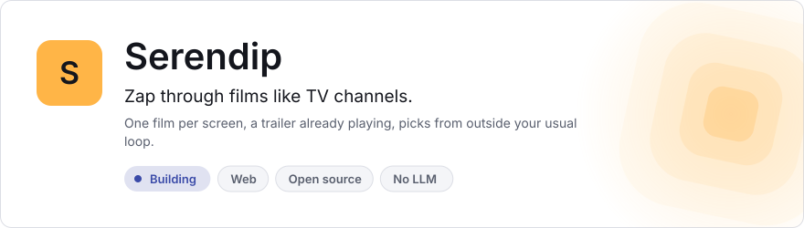
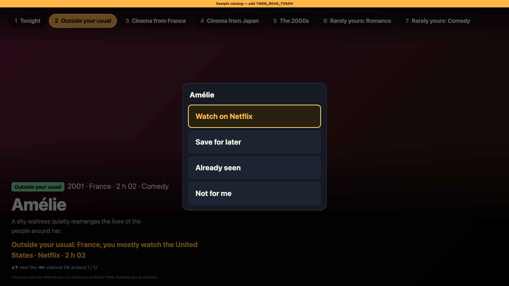
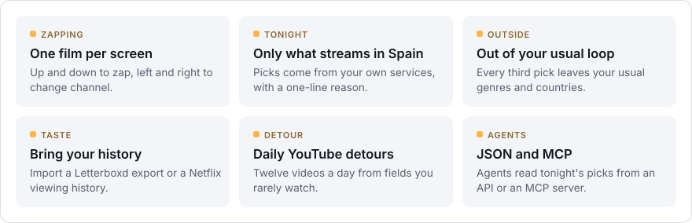
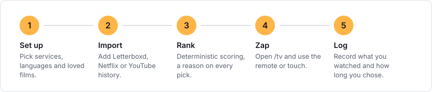

<!-- Pictures: docs/readme/spec.json, drawn by readme-kit. Do not edit the SVGs by hand. -->
<picture><source media="(prefers-color-scheme: dark)" srcset="docs/readme/hero-dark.svg"></picture>

**Find a film worth watching tonight, outside the loop a platform's recommender locked you into.**
It works like zapping TV channels, not like a grid. It is an alpha with one owner, and sprints 1, 2 and 3 ship.

[Live](https://serendip.fabriquefutur.com) · [Getting started](docs/GETTING-STARTED.md) · [Product and roadmap](docs/PRODUCT.md) · [Deploy](deploy/droplet/README.md)

<p align="center">
  
  
</p>

## What it does

<picture><source media="(prefers-color-scheme: dark)" srcset="docs/readme/highlights-dark.svg"></picture>

- **Catalog.** TMDB (Spain availability, flat rate, cached 24 h) or a labelled sample catalog.
- **Setup** (`/setup`). Services in Spain, languages, up to 15 loved films, optional disliked ones.
- **Ranking.** Deterministic and unit-tested. No model. Every pick has a one-line reason.
- **Channels.** Tonight, Outside your usual, and themed ones built from the data.
- **Lean-back view** (`/tv`). D-pad remote and touch. Two layouts for review: `?v=a` and `?v=b`.
- **Evening log** (`/log`). What you watched, from where, how much you enjoyed it, minutes to choose.
- **Usage probe.** `./check.sh usage` prints counters.
- **Sample mode.** Without `YOUTUBE_API_KEY`, Detour shows six labelled cards that do not play.
- **No LLM anywhere.** Official Google APIs only.

<details>
<summary>Imports and Detour in detail</summary>

- **Letterboxd and Netflix.** A Letterboxd export ZIP seeds taste and seen. A Netflix ViewingActivity CSV marks films as seen.
- **Takeout import** (`/setup`). Your YouTube `watch-history.json` (up to 50 MB) is read in your browser, which sends only one compact row per video. Ads, YouTube Music and removed videos are ignored.
- **The cluster** (`/setup`, `/detour`). "Your last 1,874 videos: 62 % Travel, 14 % Food" as a bar list. Topics need `YOUTUBE_API_KEY`; without it, the list is by channel.
- **Detour** (`/detour`, channel "Detour" on `/tv`). You name up to 8 fields, or tick six suggestions under 2 % of your history.
  Once a day, up to 12 YouTube searches (hard cap) become 12 videos: no Shorts, nothing watched, none from your top-30 channels,
  nothing mostly inside your cluster, a quality floor, one per channel. Watch plays full screen (youtube-nocookie); Not for me mutes a channel for 90 days.
- **Playlist** (optional, `GOOGLE_OAUTH_CLIENT_ID` and `_SECRET`). A private "Serendip Detour" playlist in your YouTube account, rewritten daily, for the TV's YouTube app.

</details>

Not yet: series, an LLM programmer, a Google TV app. See [docs/PRODUCT.md](docs/PRODUCT.md).

## How it works

<picture><source media="(prefers-color-scheme: dark)" srcset="docs/readme/steps-dark.svg"></picture>

## Quick start

```
./setup.sh                        # install, create .env with a fresh SERENDIP_OWNER_KEY, say what is missing
npm run dev -- -H 0.0.0.0         # open http://localhost:3000 and sign in with the key
# optional, for the real catalog: put a free TMDB read token in .env (docs/GETTING-STARTED.md)
# optional, for Detour: YOUTUBE_API_KEY in .env, then upload watch-history.json at /setup and name fields at /detour
# pick services and loved films at /setup, then open /tv (or /tv?v=b for the second layout)
# on the TV (same Wi-Fi): http://<mac-ip>:3000/tv     ./check.sh = the gate     ./check.sh usage = counters
```

- Without `SERENDIP_OWNER_KEY` the server refuses everything.
- Without `TMDB_READ_TOKEN` it runs on a labelled sample catalog of 32 films, with a banner that says so.
- Node 24 or newer. Data lives in `data/serendip.db` (gitignored).

## Live, deploy and agents

- **Live:** <https://serendip.fabriquefutur.com>. Bookmark `/tv` in the TV browser; the owner key signs you in once. It runs on a droplet: one container (200 MB, 128 MB heap), HTTPS by Caddy.
- **Deploy:** `./scripts/deploy.sh` (`--dry` prints the steps first). Details in [deploy/droplet/README.md](deploy/droplet/README.md).
- **JSON** for agents: `GET /api/v1/health` (public: `{ok, version}`) and `GET /api/v1/tonight` (owner key: channels with picks, where to watch in Spain, why lines, trailer keys, today's Detour).
- **MCP** at `/mcp` (bearer header) and `/mcp/<key>` (key in the URL, for connectors that cannot set a header; treat the URL as a secret). Five tools, no model: `serendip_tonight`, `serendip_channel`, `serendip_detour`, `serendip_mark`, `serendip_log_evening`.

<details>
<summary>What is where in the repo</summary>

| path | what |
|---|---|
| `app/`, `components/` | Next.js pages (`/tv`, `/setup`, `/detour`, `/log`), `/api/*` (including `/api/v1/*`) and `/mcp` |
| `src/core/` | pure ranking, "why" lines, title matching, the remote-control state machine, Takeout parser, topic histogram, Detour filter and ranking |
| `src/youtube/` | YouTube Data API v3 client, Google OAuth with PKCE, the playlist calls |
| `src/catalog/` | TMDB client with SQLite cache; the sample fixture |
| `src/import/` | Letterboxd and Netflix import |
| `src/server/` | SQLite store (`node:sqlite`), owner key auth, the feed view, the MCP server (`mcp/`) |
| `deploy/droplet/`, `scripts/deploy.sh` | the droplet image, compose and Caddy fragments, the deploy script |
| `docs/` | product and roadmap, getting started |

</details>

## Docs

| document | what is in it |
|---|---|
| [docs/GETTING-STARTED.md](docs/GETTING-STARTED.md) | setup, TMDB token, first run |
| [docs/PRODUCT.md](docs/PRODUCT.md) | product, roadmap, what is not built yet |
| [deploy/droplet/README.md](deploy/droplet/README.md) | the droplet image and the deploy script |

## Attribution

This product uses the TMDB API but is not endorsed or certified by TMDB.
Availability data by JustWatch.

Licensed under Apache-2.0.

<sub>Built by <a href="https://github.com/zaitsew">zaitsew</a> with a fleet of AI agents.</sub>
